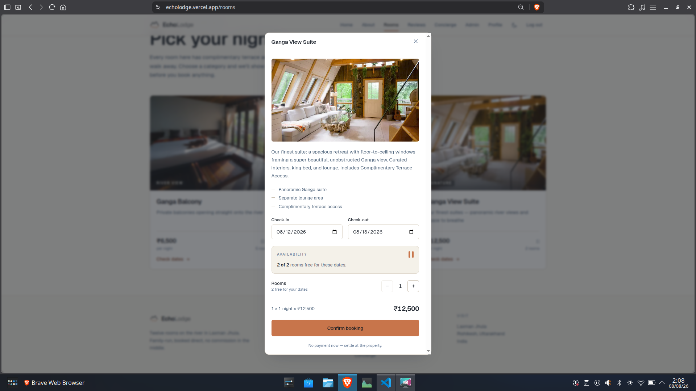
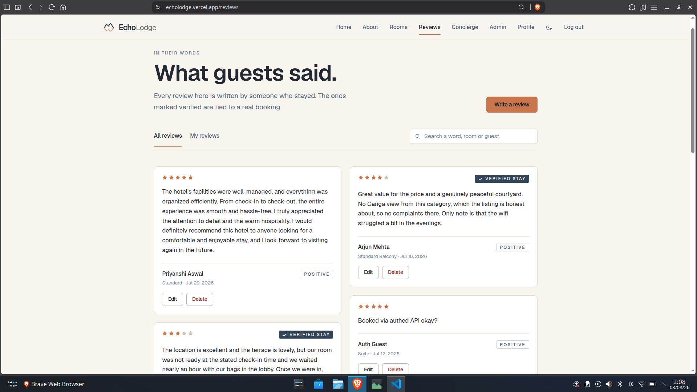
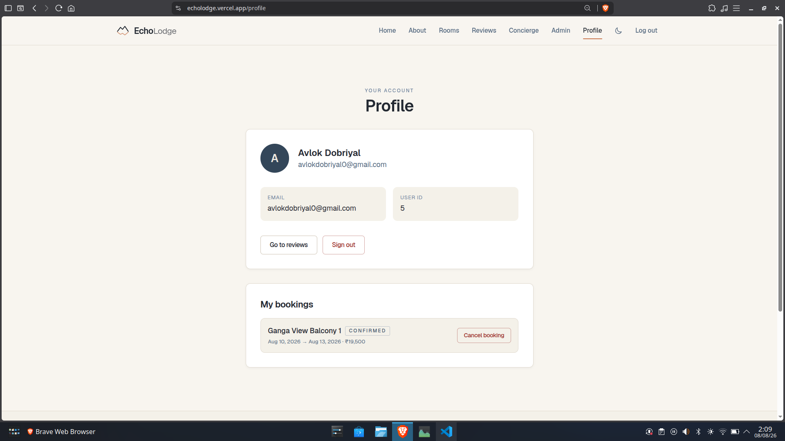
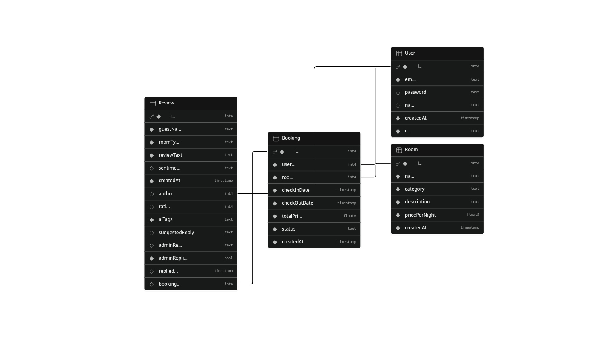

# EchoLodge

> An eco-tourism and homestay booking platform — browse rooms, check live availability, book direct, and review your stay.

EchoLodge is the direct-booking site for a twelve-room riverside lodge in Laxman
Jhula, Rishikesh. One property, not a marketplace: guests browse the three room
categories, check real availability, book directly, and review their stay
afterwards. Booking here means no travel-site commission in the middle.

---

## Live Demo

**[Live Demo](https://echolodge.vercel.app)**

| Service | URL |
|---|---|
| **Live Frontend** (Vercel) | **https://echolodge.vercel.app** |
| **Live Backend / API** (Render) | **https://echolodge-00cc.onrender.com** |
| Backend health check | https://echolodge-00cc.onrender.com/api/health |

> First load may take 30–50 seconds if the backend has been idle — see
> [Known Limitations](#known-limitations).

---

## Demo Video

**[Demo Video](insert-youtube-link)**

---

## Screenshots


*Home — full-bleed hero over the property, with live inventory below.*


*Availability ledger — one mark per real room, warm if it's free for the chosen dates.*


*Reviews — Gemini-derived sentiment and server-verified stay badges.*


*Profile — the signed-in guest's bookings and account.*

---

## Features

**Booking**
- Three room categories (Ganga View Balcony, Standard Balcony, Super Deluxe Ganga View Suite) across 12 rooms, driven entirely by the live inventory.
- **Direct booking with a live availability ledger.** The modal queries `GET /api/rooms/availability` as soon as the dates are valid, draws one mark per real room, clamps the quantity stepper to what is actually free, and disables the button when a category is full — so a guest never fills in a whole form only to be rejected.
- **No double-booking, ever.** Bookings are created inside a **Serializable** Postgres transaction, so two concurrent requests can never claim the same room. Conflicts return a retryable `409`.
- Past-dated stays are rejected server-side, not just hidden by the date picker.
- No payment is taken — a booking is a reservation, settled at the property.

**Reviews**
- **AI review classification.** Every review is run through Google Gemini on submit for sentiment (`POSITIVE` / `NEUTRAL` / `NEGATIVE`), internal tags, and a drafted reply for the owner. If the AI call fails the review still saves with empty AI fields, and an admin can re-run the analysis from the dashboard.
- Publicly readable — no sign-in required to read them. Writing, editing and deleting require an account.
- Full-text search across review text, sentiment, guest name and room type.
- **Verified stay** badge: a review can be attached to one of the guest's own bookings. Ownership is resolved server-side, so the badge cannot be spoofed by the client, and each booking can back at most one review.

**Admin**
- **Role-based admin access.** Room catalogue management and a review inbox with AI-drafted replies.
- Admin rights are **not** grantable over the API. They are set only by whoever holds the database credentials, via `npm run set-admin`. `requireAdmin` re-reads the role from the database on every request, so revoking access takes effect immediately rather than waiting out a 30-day token.

**Security**
- **Secure rate limiting.** Login is throttled per *targeted account* rather than per IP, so a shared egress IP — which is what you get when auth runs server-side on Vercel — cannot lock out unrelated users. Separate limits guard registration and the OAuth exchange.
- All request bodies validated with Zod; passwords hashed with bcrypt; the API issues and verifies its own JWT.

**AI Concierge**
- `POST /api/ai/itinerary` builds a day-by-day Rishikesh itinerary anchored to the lodge. Prompt iterations are documented in [`PROMPTS.md`](./PROMPTS.md).

**Interface**
- Light and dark themes, applied before first paint so there is no flash on load.
- WCAG AA contrast throughout, visible keyboard focus, and `prefers-reduced-motion` respected across every animation.

---

## Tech Stack

### Frontend
- **Next.js 16** (App Router, Turbopack)
- **React 19**
- **Tailwind CSS v4** — CSS-first `@theme` token system, no JS config
- **Motion** (the `motion` package — Framer Motion's successor) for scroll reveals, staggered grids and spring dialogs
- **NextAuth v4** — Credentials + Google OAuth, JWT session strategy
- **react-hot-toast** for notifications

### Backend
- **Node.js** + **Express 5**
- **Prisma ORM v6**
- **Zod v4** for request validation
- **jsonwebtoken** for API auth, **bcrypt** for password hashing
- **express-rate-limit** for auth throttling

### Database
- **Supabase PostgreSQL**
- Transaction pooler (port `6543`) for app queries; session pooler (port `5432`) for schema commands

### AI
- **Google Gemini** (`gemini-flash-latest`) via `@google/genai` — review sentiment analysis, drafted admin replies, and the trip-planning Concierge

### Deployment
- **Vercel** — frontend
- **Render** — Express API
- **Supabase** — managed Postgres

| Layer | Technology | Hosted on |
|---|---|---|
| **Frontend** | Next.js 16 · React 19 · Tailwind CSS v4 · Motion · NextAuth | **Vercel** |
| **Backend** | Node.js · Express 5 · Zod · JWT · express-rate-limit | **Render** |
| **Database** | PostgreSQL via **Prisma ORM**, through the transaction pooler | **Supabase** |
| **AI** | Google Gemini (`gemini-flash-latest`) | Google AI Studio |

---

## Setup Instructions

### 1. Clone

```bash
git clone https://github.com/avlokdobriyal/EchoLodge.git
cd EchoLodge
```

### 2. Install dependencies

The frontend and backend are separate npm packages, so install both:

```bash
npm install                     # frontend (repo root)
npm install --prefix backend    # backend
```

### 3. Environment variables

Copy both example files and fill in real values. **Never commit the real `.env`
files** — they are already gitignored.

```bash
cp .env.example .env                  # frontend (NextAuth, Google OAuth, API URL)
cp backend/.env.example backend/.env  # backend (Supabase, JWT, Gemini, CORS)
```

#### Frontend — `.env` (repo root)

| Variable | Purpose |
|---|---|
| `NEXTAUTH_SECRET` | Long random string used to sign the NextAuth session JWT |
| `NEXTAUTH_URL` | The frontend's own URL. `http://localhost:3000` locally; the live Vercel URL in production |
| `GOOGLE_CLIENT_ID` | Google OAuth client ID (Google Cloud Console → APIs → Credentials) |
| `GOOGLE_CLIENT_SECRET` | Google OAuth client secret |
| `NEXT_PUBLIC_API_URL` | Origin of the Express API. Leave unset locally to fall back to `http://localhost:5000`; on Vercel set it to the live Render URL |

> `NEXT_PUBLIC_API_URL` is inlined into the browser bundle at build time — never
> put a secret behind a `NEXT_PUBLIC_` prefix.

#### Backend — `backend/.env`

| Variable | Purpose |
|---|---|
| `DATABASE_URL` | Supabase **transaction** pooler, port **6543**, with `?pgbouncer=true`. Used for all app queries |
| `DIRECT_URL` | Supabase **session** pooler, port **5432**. Used only by Prisma for schema work (`db push`, `migrate`, `db execute`) |
| `JWT_SECRET` | Long random string used to sign the backend's own API tokens |
| `GEMINI_API_KEY` | Google AI Studio key for review analysis and the Concierge |
| `GEMINI_MODEL` | *Optional.* Pin a specific model (defaults to `gemini-flash-latest`) |
| `FRONTEND_URL` | The origin allowed by CORS. Can stay unset locally (`localhost:3000` is always allowed); set it to the live Vercel URL in production |
| `PORT` | *Optional.* Render injects this automatically; local default is `5000` |

> **Important:** `DIRECT_URL` must use port **5432**, not 6543. DDL cannot run
> through transaction-mode pooling, so pointing it at 6543 makes
> `prisma db push` hang silently with no error.

### 4. Create the schema and seed it

Point the project at your own database in three steps:

1. **Create a Supabase project** and copy both connection strings from
   **Project Settings → Database** (pooled `DATABASE_URL` on 6543, direct
   `DIRECT_URL` on 5432).
2. **Add them** to `backend/.env` (see `backend/.env.example`).
3. **Create the schema and seed it:**

```bash
cd backend
npx prisma generate
npm run db:push      # push the Prisma schema to your database
npm run db:seed      # 12-room inventory + demo verified stays (idempotent)
```

Seeding creates the 12-room inventory plus a few past guests with completed
bookings and reviews linked to them, so the "Verified stay" badge and the AI
review pipeline have something to demonstrate. The demo accounts are
passwordless and cannot be signed into. Re-running the seed is a no-op.

### 5. Grant yourself admin

Admin rights are deliberately not exposed over the API. Register an account
through the UI first, then from the `backend/` directory:

```bash
npm run set-admin -- you@example.com            # grant ADMIN
npm run set-admin -- you@example.com --revoke   # revoke
npm run set-admin -- --list                     # list current admins
```

### 6. Run locally

Two terminals:

```bash
# terminal 1 — backend
cd backend
npm run dev          # http://localhost:5000
```

```bash
# terminal 2 — frontend
npm run dev          # http://localhost:3000
```

With `NEXT_PUBLIC_API_URL` unset, the frontend falls back to `http://localhost:5000`.

### Backend scripts reference

| Command | What it does |
|---|---|
| `npm run dev` | Start the API with nodemon |
| `npm start` | Start the API (used by Render) |
| `npm run prisma:generate` | Regenerate the Prisma client |
| `npm run db:push` | Sync the Prisma schema to the database |
| `npm run db:seed` | Seed rooms and demo verified stays (idempotent) |
| `npm run set-admin -- <email>` | Grant ADMIN (`--revoke` to remove, `--list` to show) |

---

## API Documentation

Base URL: `http://localhost:5000/api` locally, or your Render URL in production.

Authenticated routes expect the backend JWT as `Authorization: Bearer <token>`.
All validation failures return `400` with
`{ "error": "Invalid input", "details": { ... } }`.

### `GET /api/health`

Liveness probe. Deliberately does **not** touch the database, so it reports that
the service is up even when the database is not.

```json
{ "status": "ok", "uptime": 1284.51 }
```

### `GET /api/rooms`

Public. Returns the full room list.

```json
[
  {
    "id": 1,
    "name": "Ganga View Balcony 101",
    "category": "Ganga View Balcony",
    "description": "A premium room with a private balcony overlooking the sacred Ganga.",
    "pricePerNight": 6500,
    "createdAt": "2026-06-22T18:14:03.221Z"
  }
]
```

### `GET /api/rooms/availability`

Public. How many rooms in a category are genuinely free for a date range — this
is what lets the booking UI show availability up front instead of rejecting a
completed form with a `409`.

**Request** (query string)

```
GET /api/rooms/availability?category=Ganga%20View%20Balcony&checkIn=2026-09-10&checkOut=2026-09-13
```

**Response** `200`

```json
{
  "category": "Ganga View Balcony",
  "inventory": 5,
  "available": 3
}
```

**Errors** — `400` if `checkOut <= checkIn` or a date is unparseable; `404` if no
rooms exist in that category.

### `POST /api/auth/register`

Public. Creates an account and returns a backend JWT.

**Request**

```json
{
  "email": "priya@example.com",
  "password": "at-least-6-chars",
  "name": "Priya Sharma"
}
```

**Response** `201`

```json
{
  "token": "eyJhbGciOiJIUzI1NiIsInR5cCI6IkpXVCJ9...",
  "user": {
    "id": 12,
    "email": "priya@example.com",
    "name": "Priya Sharma",
    "role": "USER",
    "createdAt": "2026-08-04T09:22:41.118Z"
  }
}
```

`POST /api/auth/login` takes `{ email, password }` and returns the same shape
with `200`. Both are rate limited — login is keyed on the targeted email address
rather than the caller's IP.

### `POST /api/bookings/category`

**Authenticated.** Books `quantity` rooms from a category. The availability check
and every insert share one **Serializable** transaction, so concurrent requests
cannot oversell the category.

**Request**

```json
{
  "category": "Ganga View Balcony",
  "quantity": 2,
  "checkIn": "2026-09-10",
  "checkOut": "2026-09-13"
}
```

**Response** `201`

```json
{
  "bookings": [
    {
      "id": 48,
      "userId": 12,
      "roomId": 1,
      "checkInDate": "2026-09-10T00:00:00.000Z",
      "checkOutDate": "2026-09-13T00:00:00.000Z",
      "totalPrice": 19500,
      "status": "CONFIRMED",
      "createdAt": "2026-08-04T09:31:07.442Z",
      "room": { "name": "Ganga View Balcony 101", "category": "Ganga View Balcony" }
    }
  ],
  "nights": 3,
  "quantity": 2,
  "totalPrice": 39000
}
```

**Errors**

- `400` — `checkOut must be after checkIn`, or `checkIn cannot be in the past`
- `404` — `No rooms found in this category`
- `409` — not enough free rooms, with the live count attached:

```json
{
  "error": "Only 1 room(s) of this category are available for the selected dates",
  "available": 1
}
```

### `GET /api/bookings`

**Authenticated.** The caller's own bookings, resolved from the JWT — there is no
user id in the path, so one guest can never request another's stays.
`PATCH /api/bookings/:id/cancel` soft-cancels a stay; `DELETE /api/bookings/:id`
removes a cancelled one.

### `POST /api/reviews`

**Authenticated.** Creates a review. Passing `bookingId` attaches the review to
one of your own stays, which is what earns the **Verified stay** badge; ownership
is resolved server-side, so the client cannot fake it. The review is run through
Gemini before saving — if that call fails the review still saves with empty AI
fields.

**Request**

```json
{
  "guestName": "Priya Sharma",
  "roomType": "Ganga View Balcony",
  "reviewText": "We woke every morning to the aarti bells drifting up from the ghat.",
  "rating": 5,
  "bookingId": 48
}
```

**Response** `201`

Internal AI fields (`aiTags`, `suggestedReply`) and the raw `bookingId` are
stripped from public payloads; `verifiedStay` is surfaced as a plain boolean
instead.

```json
{
  "id": 31,
  "guestName": "Priya Sharma",
  "roomType": "Ganga View Balcony",
  "reviewText": "We woke every morning to the aarti bells drifting up from the ghat.",
  "rating": 5,
  "createdAt": "2026-08-04T09:35:12.907Z",
  "authorId": 12,
  "sentiment": "POSITIVE",
  "adminReply": null,
  "adminReplied": false,
  "repliedAt": null,
  "verifiedStay": true
}
```

### `GET /api/reviews` · `GET /api/reviews/search?q=`

Public, no auth required. `search` matches across review text, sentiment, guest
name and room type, newest first.

```
GET /api/reviews/search?q=balcony
```

`GET /api/reviews/mine` returns the signed-in guest's own reviews.
`PUT /api/reviews/:id` and `DELETE /api/reviews/:id` are restricted to the
review's author or an admin.

### `POST /api/reviews/:id/reply` · `POST /api/reviews/:id/regenerate`

**Admin only.** Publish a reply to a review, or re-run the Gemini analysis
(useful after an AI outage left the fields empty).

**Request**

```json
{ "reply": "Thank you Priya — we're glad the terrace treated you well." }
```

### `POST /api/ai/itinerary`

**Authenticated.** Builds a day-by-day Rishikesh itinerary anchored to the lodge.

```json
{ "prompt": "3 relaxed days — morning yoga, river views, quiet cafes" }
```

---

## Architecture / Folder Structure

### How the pieces interact

The browser talks to **Next.js on Vercel**, which renders the UI and owns the
browser session through NextAuth. Every data request then goes to the **Express
API on Render**, which is the only thing that talks to **Supabase Postgres** —
the frontend never holds a database credential.

Authentication is split deliberately: NextAuth owns the browser session, while
the Express API issues and verifies its own JWT. Credential logins and Google
sign-ins both exchange through the backend, so a single token type reaches the
API regardless of how the guest signed in.

```
Browser ──► Vercel (Next.js App Router, NextAuth session)
               │
               │  Authorization: Bearer <backend JWT>
               ▼
            Render (Express API, Zod validation, rate limiting)
               │                    │
               ▼                    ▼
        Supabase Postgres      Google Gemini
          (via Prisma)      (review analysis, concierge)
```

### Folder tree

```
echolodge/
├── src/                          # Next.js frontend
│   ├── app/                      # App Router — one folder per route
│   │   ├── admin/                # Admin dashboards (rooms, review inbox)
│   │   ├── api/auth/             # NextAuth route handler
│   │   ├── rooms/                # Browsing + booking modal
│   │   ├── reviews/              # Public reviews + search
│   │   ├── concierge/            # AI itinerary planner
│   │   ├── profile/              # Guest bookings
│   │   ├── about/  login/  register/
│   │   ├── globals.css           # Tailwind v4 @theme design tokens
│   │   └── layout.js             # Root layout, providers, no-flash theme script
│   ├── components/
│   │   ├── ui/                   # Primitives: Button, Input, Modal, Photo…
│   │   ├── motion/               # Reveal, Stagger, Counter (reduced-motion aware)
│   │   └── RoomLedger.jsx        # Availability drawn as one mark per room
│   └── lib/                      # API base URL, category metadata, hooks
│
├── backend/                      # Express API
│   ├── routes/                   # auth · rooms · bookings · reviews · ai
│   ├── middleware/               # requireAuth, requireAdmin
│   ├── services/                 # reviewAI.js — the Gemini pipeline
│   ├── scripts/                  # set-admin.js (owner-only CLI)
│   ├── lib/                      # Prisma client singleton
│   ├── prisma/
│   │   ├── schema.prisma         # User · Room · Booking · Review
│   │   ├── seed.js               # Idempotent inventory + demo stays
│   │   └── sql/                  # Guarded additive migrations
│   └── server.js                 # Entry point, CORS, trust proxy, keep-alive
│
├── public/
│   ├── rooms/                    # Room photography
│   └── screenshots/              # README screenshots
│
├── EchoLodge_DatabaseSchema.png  # ER diagram
├── PROMPTS.md                    # Gemini prompt iterations
└── README.md
```

### Database schema

The Express API is backed by PostgreSQL through
[Prisma](https://www.prisma.io/). A relational database fits because bookings,
reviews, rooms and users are highly structured and genuinely related — a review
points at the booking that justifies it, and a booking points at both the room
and the guest. Supabase's managed Postgres also provides a transaction pooler,
which keeps connections stable for an API made of many short-lived requests.

[](./EchoLodge_DatabaseSchema.png)

*Click the diagram to view it full size. Source of truth is
[`backend/prisma/schema.prisma`](./backend/prisma/schema.prisma).*

Four tables, and the relationships are what carry the business rules:

- **User → Booking** — a guest holds many stays. `password` is nullable, because
  Google OAuth users never have one locally.
- **Room → Booking** — each booking reserves one specific room. Rooms are sold
  by `category`, so the API picks free rooms within a category and books them
  atomically.
- **User → Review** — `authorId` records who wrote a review, so only the author
  or an admin can edit it.
- **Booking → Review** — `bookingId` is what makes a review a **verified stay**.
  It is unique, so one stay backs at most one review, and `ON DELETE SET NULL`
  means deleting a booking downgrades the review to unverified rather than
  destroying the guest's words. It stays nullable so guests who booked at the
  front desk can still review.

`sentiment`, `aiTags` and `suggestedReply` on **Review** are written by the
Gemini pipeline, and are all nullable so a review still saves when the AI call
fails.

---

## Known Limitations

Every service in this stack runs on a free plan. These are the constraints that
are actually visible in production, and what has been done about each.

**1. Render spins the backend down after ~15 minutes of inactivity.**
The next request then has to start the service from cold, which takes roughly
**30–50 seconds** — measured at 22s on this project. Because the homepage and
rooms page fetch live inventory on load, that delay is the first thing a visitor
would see.

*Mitigation:* the server keeps itself awake by pinging its own health check
every 12 minutes, using the `RENDER_EXTERNAL_URL` that Render injects (see
*Keep-alive* in `backend/server.js`). This runs inside the process, so it
narrows the window rather than closing it — a cold start is still possible
immediately after a deploy, before the first ping cycle. When it happens, the
rooms page explains the wait after 4 seconds instead of showing a spinner that
looks broken.

**2. Supabase pauses free projects after extended inactivity.**
Note that the keep-alive above does *not* prevent this: `/api/health`
deliberately avoids touching the database so it can report that the service is
up even when the database is not. Keeping the API warm therefore does not keep
Postgres warm. If the project has been idle for a long stretch, it may need to
be resumed from the Supabase dashboard before the site works.

**3. Free-tier compute is limited and single-instance.**
The API runs as one small shared-CPU instance with no horizontal scaling, so
throughput is modest. This is partly why booking writes use a Serializable
transaction and return a retryable `409` on conflict rather than relying on
application-level locking.

**4. Gemini's free tier is rate-limited.**
Under heavy use, review analysis can fail. This is handled rather than
surfaced: `analyzeReview` returns `null` on any failure, the review still saves
with empty AI fields, and an admin can re-run the analysis from the dashboard.
A guest's submission is never lost to an upstream outage.

**5. Vercel's Hobby plan is for non-commercial use.**
Taking real bookings for the lodge would require a paid plan.

**6. No payment processing.**
A booking is a reservation, not a paid transaction — there is no payment
gateway integrated. Guests settle at the property.

**7. Room photography is placeholder art.**
The current images are stand-ins sourced for demonstration, not photographs of
the property.

---

## Credits & Acknowledgements

### AI tools used

- **Google Gemini** — powers the product itself: review sentiment analysis,
  drafted admin replies, and the trip-planning Concierge. Prompt iterations are
  documented in [`PROMPTS.md`](./PROMPTS.md).
- **Claude (Anthropic)** — used as a development assistant for architecture
  review, the design system, security hardening of the auth and booking paths,
  and documentation.

### Libraries and services

- [Next.js](https://nextjs.org/) · [React](https://react.dev/) · [Tailwind CSS](https://tailwindcss.com/) · [Motion](https://motion.dev/)
- [NextAuth.js](https://next-auth.js.org/) · [Express](https://expressjs.com/) · [Prisma](https://www.prisma.io/) · [Zod](https://zod.dev/)
- [react-hot-toast](https://react-hot-toast.com/) · [express-rate-limit](https://express-rate-limit.mintlify.app/)
- [Supabase](https://supabase.com/) · [Vercel](https://vercel.com/) · [Render](https://render.com/)
- Placeholder room photography from [Unsplash](https://unsplash.com/)

### Thanks

To the team at EchoLodge, Laxman Jhula — for the terrace, the chai, and the
reason to build this.
